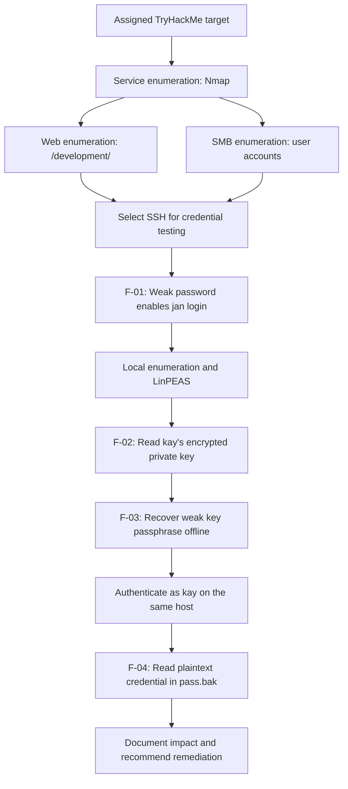

# Cybersecurity Case Study: Internal Network Penetration Testing & Lateral Movement

## 1. Project Overview

  -----------------------------------------------------------------------------------------------
  Item                                Details
  ----------------------------------- -----------------------------------------------------------
  **Project Title**                   Internal Network Penetration Testing & Lateral Movement
                                      Case Study

  **Lab Platform**                    TryHackMe

  **Room**                            [Basic
                                      Pentesting](https://tryhackme.com/room/basicpentestingjt)

  **Assessment Type**                 Internal Network Security Assessment

  **Objective**                       Identify exposed services, enumerate potential attack
                                      vectors, exploit credential weaknesses, perform lateral
                                      movement, and retrieve sensitive information in a
                                      controlled lab environment.

  **Target IP**                       `10.x.x.x` (anonymized)

  **Operating System**                Linux (Ubuntu; version not independently verified)

  **Domain / Workgroup**              `WORKGROUP`

  **Scope**                           The assigned TryHackMe lab target only
  -----------------------------------------------------------------------------------------------

### Tools Used

-   Nmap
-   Gobuster
-   Enum4linux
-   Hydra
-   SSH
-   LinPEAS
-   John the Ripper
-   `ssh2john.py`
-   SCP

------------------------------------------------------------------------

### 1.1 Assessment and Observed Attack Flow

The diagram links the enumeration activities to the attack path documented
in Sections 2–4. Service and directory discovery supplied context; they
were not independently demonstrated exploits.



**Observed endpoint:** Access to `kay` and disclosure of the credential in
`pass.bak`. Root access, another compromised host, successful use of the
backup password, and service disruption were not demonstrated. Movement
between the two accounts is lateral account compromise on the same host.

------------------------------------------------------------------------

## 2. Reconnaissance and Enumeration

The reconnaissance phase focused on identifying network services,
exposed web directories, and potentially valid user accounts on the
target.

### 2.1 Port and Service Enumeration

A service-version scan was performed using Nmap to identify exposed
ports and running services.

**Command:**

``` bash
nmap -sV 10.x.x.x
```

**Identified services:**

  Port         Service   Version / Details
  ------------ --------- ---------------------
  `22/tcp`     SSH       OpenSSH 8.2p1
  `80/tcp`     HTTP      Apache 2.4.41
  `139/tcp`    SMB       Samba
  `445/tcp`    SMB       Samba
  `8009/tcp`   AJP       AJP13
  `8080/tcp`   HTTP      Apache Tomcat 9.0.7

**Finding:** Several services were exposed, providing multiple potential
enumeration and attack surfaces. SSH and SMB were selected for further
investigation, alongside the web service.

### 2.2 Web Directory Enumeration

Gobuster was used to discover accessible directories and potentially
hidden web content.

**Command:**

``` bash
gobuster dir -u http://10.x.x.x -w /usr/share/wordlists/dirb/common.txt
```

**Finding:**

-   Discovered `/development/`
-   HTTP status code: `301` (redirect)

The discovered directory was investigated for information that could
assist subsequent enumeration.

### 2.3 SMB Enumeration

Enum4linux was used to gather information from the SMB service,
including workgroup information and user enumeration.

**Command:**

``` bash
enum4linux -a 10.x.x.x
```

**Finding:**

The enumeration identified the following user accounts:

-   `jan`
-   `kay`
-   `ubuntu`

These usernames were used to guide subsequent credential testing.

------------------------------------------------------------------------

## 3. Initial Access

### 3.1 Vulnerability Identified

The SSH service allowed authentication using a weak password associated
with the account `jan`.

**Attack Vector:** Weak account credentials\
**Affected Service:** SSH (`22/tcp`)\
**Affected Account:** `jan`

### 3.2 Credential Testing

In the authorized lab environment, Hydra was used to test the identified
account against a password wordlist.

**Command:**

``` bash
hydra -l jan -P /usr/share/wordlists/rockyou.txt ssh://10.x.x.x
```

**Result:**

  Username   Password
  ---------- -----------
  `jan`      `armando`

The password was successfully identified during the lab exercise.

### 3.3 SSH Authentication

The credentials were then used to authenticate to the target over SSH.

**Command:**

``` bash
ssh jan@10.x.x.x
```

**Result:**

Successful authentication provided a shell under the `jan` account.

``` text
jan@ip-10-x-x-x:~$
```

**Security Impact:** An attacker able to reach the SSH service could
gain unauthorized access to a local user account through password
guessing if weak credentials were used.

------------------------------------------------------------------------

## 4. Post-Exploitation and Lateral Movement

After obtaining initial access, local enumeration was performed to
identify additional accounts, accessible files, and potential paths to
other users.

### 4.1 Local Account and File Enumeration

Local account information was reviewed to identify user accounts and
their home directories.

**Areas examined:**

-   `/etc/passwd`
-   `/home/jan`
-   `/home/kay`

The enumeration confirmed the presence of additional user profiles,
including `kay`.

### 4.2 LinPEAS Enumeration

LinPEAS was transferred to a temporary directory on the target for local
security enumeration.

**Transfer command:**

``` bash
scp linpeas.sh jan@10.x.x.x:/dev/shm/
```

The script was used to inspect local configuration, file permissions,
credentials, and potential privilege-escalation paths.

### 4.3 SSH Private Key Discovery

During local enumeration, an SSH private key belonging to the `kay`
account was discovered at:

``` text
/home/kay/.ssh/id_rsa
```

The key was readable from the compromised account, indicating inadequate
access restrictions on sensitive SSH authentication material.

**Finding:** The private key was accessible to an unauthorized local
user.

**Security Impact:** Exposure of a private SSH key can enable
unauthorized authentication to the associated account, particularly if
the key's passphrase is weak or can be recovered.

### 4.4 Private Key Passphrase Recovery

The SSH private key was converted into a format suitable for offline
password cracking using `ssh2john.py`.

**Command:**

``` bash
/usr/share/john/ssh2john.py kay_id_rsa > forjohn.txt
```

John the Ripper was then used to test candidate passphrases against the
converted hash.

**Command:**

``` bash
john forjohn.txt --wordlist=/usr/share/wordlists/rockyou.txt
```

**Result:**

  Item                   Result
  ---------------------- ----------------------------
  Target account         `kay`
  Credential type        SSH private key passphrase
  Recovered passphrase   `beeswax`

The passphrase was successfully recovered during the lab exercise.

### 4.5 Lateral Movement to the `kay` Account

The recovered private key and passphrase were used to authenticate as
`kay`.

**Command:**

``` bash
ssh -i kay_id_rsa kay@10.x.x.x
```

**Result:**

Authentication as the `kay` account was successful, demonstrating
lateral movement from the initially compromised `jan` account to another
local user account.

### 4.6 Sensitive File Retrieval

After accessing the `kay` account, a backup file named `pass.bak` was
located and read.

**Command:**

``` bash
cat pass.bak
```

**Recovered content:**

``` text
heresareallystrongpasswordthatfollowsthepasswordpolicy$$
```

**Finding:** A sensitive credential was stored in a backup file in a
readable form.

**Security Impact:** Plain-text credential storage can expose passwords
to anyone who obtains access to the file or the account that can read
it.

------------------------------------------------------------------------

## 5. Findings and Risk Assessment

  -----------------------------------------------------------------------
  ID                Finding           Evidence          Priority
  ----------------- ----------------- ----------------- -----------------
  F-01              Weak SSH password Password for      High
                                      `jan` recovered   
                                      through wordlist  
                                      testing           

  F-02              Excessive access  `jan` could       High
                    to SSH private    access `kay`'s    
                    key               private key       

  F-03              Weak SSH key      Passphrase        High
                    passphrase        recovered through 
                                      offline cracking  

  F-04              Sensitive         `pass.bak`        High
                    credential stored contained a       
                    in backup file    password in       
                                      readable form     

  F-05              Multiple exposed  SSH, HTTP, SMB,   Informational;
                    network services  AJP, and Tomcat   review exposure
                                      services          and configuration
                                      identified        
  -----------------------------------------------------------------------

### Overall Risk

**Overall Assessment: High**

The combined weaknesses enabled an attacker to obtain initial access to
a user account, access another user's SSH authentication material, move
laterally to that account, and retrieve sensitive credentials.

The severity of individual findings may vary depending on the network
exposure, account privileges, credential reuse, and the sensitivity of
the recovered information.

------------------------------------------------------------------------

### 5.1 CWE Mapping and CVSS v3.1 Summary

The preceding table records qualitative remediation priorities. The
following table provides separate **analyst-assigned CVSS v3.1 Base
scores**, based on the report's evidence and the explicit assumptions
below. These are not vendor or NVD ratings. The original blanket High
priorities do not mean that every finding has a High CVSS severity.
F-05 is reassessed as an informational observation.

| ID | Primary CWE mapping | CVSS v3.1 Base vector | Score | Severity |
| --- | --- | --- | --- | --- |
| F-01 | CWE-521 — Weak Password Requirements, provisional policy mapping | `CVSS:3.1/AV:N/AC:L/PR:N/UI:N/S:U/C:L/I:L/A:N` | 6.5 | Medium |
| F-02 | CWE-732 — Incorrect Permission Assignment for Critical Resource | `CVSS:3.1/AV:L/AC:L/PR:L/UI:N/S:U/C:L/I:N/A:N` | 3.3 | Low |
| F-03 | CWE-521 — Weak Password Requirements, provisional passphrase-policy mapping | `CVSS:3.1/AV:L/AC:L/PR:L/UI:N/S:U/C:L/I:L/A:N` | 4.4 | Medium |
| F-04 | CWE-256 — Plaintext Storage of a Password | `CVSS:3.1/AV:L/AC:L/PR:L/UI:N/S:U/C:L/I:N/A:N` | 3.3 | Low |
| F-05 | Not assigned: exposed services alone do not establish a specific weakness | Not scored | N/A | Informational |

**Scoring basis.** Base metrics describe each weakness at its own entry
point. F-02–F-04 require an existing local account in this assessment;
their scores do not inherit F-01's unauthenticated network entry. The
accounts are treated as ordinary users under one operating-system
security authority. Changing users alone does not establish Changed
Scope. Low confidentiality reflects the bounded information documented;
Low integrity for F-01/F-03 assumes normal write permissions of the
compromised account. No availability impact is established. These
assumptions should be revised if broader privileges or impacts are
confirmed. Method: FIRST CVSS v3.1 specification [1] and user guide [2].

### 5.2 F-01 — Weak SSH Password

**Evidence:** Sections 3.2–3.3 report wordlist recovery of `jan`'s password
and successful SSH authentication.

**CWE analysis:** CWE-521 [3] is a provisional mapping to insufficient
password-strength enforcement. The weak password is demonstrated, but
the configured password policy and password-setting controls were not
inspected. This is a lab configuration finding, not proof of a defect in
OpenSSH. Successful guessing alone does not establish CWE-307 (Improper
Restriction of Excessive Authentication Attempts); lockout, throttling,
and attempt timing were not documented.

| Metric | Value | Finding-specific rationale |
| --- | --- | --- |
| Attack Vector | Network (N) | SSH was reachable from the assessor's network. An internal address does not by itself make this Adjacent. |
| Attack Complexity | Low (L) | A common wordlist recovered the password without a documented race or exceptional prerequisite. |
| Privileges Required | None (N) | Knowing an enumerated username did not require an authenticated account. |
| User Interaction | None (N) | The account owner did not need to act. |
| Scope | Unchanged (U) | Access remained within the assessed host's operating-system authority. |
| Confidentiality | Low (L) | Access to ordinary user information is supported; host-wide disclosure is not established. |
| Integrity | Low (L) | The shell is assumed to permit changes to files owned by `jan`; no system-level write access was demonstrated. |
| Availability | None (N) | Disruption of a protected service or host was not established. |

**Result:** **6.5 — Medium**. High remediation priority remains reasonable
because this was the remotely reachable entry point to the observed
chain. If ordinary account write access is not accepted as a supported
assumption, the read-only alternative is
`CVSS:3.1/AV:N/AC:L/PR:N/UI:N/S:U/C:L/I:N/A:N` (**5.3 — Medium**).

### 5.3 F-02 — Excessive Access to an SSH Private Key

**Evidence:** Section 4.3 reports that `jan` could read
`/home/kay/.ssh/id_rsa`. Section 4.4 establishes that the key was
passphrase-protected.

**CWE analysis:** CWE-732 [4] fits the reported cross-user read access to
a security-critical key. Numeric mode bits, ownership, ACLs, and parent
directory permissions were not captured, so the precise permission
mechanism remains unverified. The key was not reported to be plaintext;
its exposure and the weak passphrase are separate weaknesses.

| Metric | Value | Finding-specific rationale |
| --- | --- | --- |
| Attack Vector | Local (L) | Reading the key required access to the host's filesystem, even though the shell was reached over SSH. |
| Attack Complexity | Low (L) | The key was readable through ordinary local enumeration. |
| Privileges Required | Low (L) | An existing unprivileged account, `jan`, was required. |
| User Interaction | None (N) | `kay` did not need to participate. |
| Scope | Unchanged (U) | Both users were governed by the same host security authority. |
| Confidentiality | Low (L) | One encrypted private-key file was exposed; key decryption depends on F-03. |
| Integrity | None (N) | Write access to the key or another protected resource was not shown. |
| Availability | None (N) | Reading the key did not establish disruption. |

**Result:** **3.3 — Low** for the isolated encrypted-file disclosure.
Its operational priority is High in this lab because F-03 converted the
exposed key into usable authentication material. This score isolates
the read-permission weakness rather than counting the complete chain
again.

### 5.4 F-03 — Weak SSH Key Passphrase

**Evidence:** Sections 4.4–4.5 report recovery of the passphrase with a
wordlist and successful authentication as `kay` using the key.

**CWE analysis:** CWE-521 [3] is a provisional mapping for weak
passphrase strength. Passphrase policy enforcement was not inspected.
CWE-522 — Insufficiently Protected Credentials [5] describes the broader
credential-protection issue, but CWE-521 more directly expresses the
weak secret in this case. The evidence does not establish broken key
encryption or an SSH cryptographic implementation flaw.

| Metric | Value | Finding-specific rationale |
| --- | --- | --- |
| Attack Vector | Local (L) | The assessed route required obtaining a private-key artifact from the host before offline recovery. |
| Attack Complexity | Low (L) | The documented wordlist recovered this passphrase; using an offline cracking tool does not automatically imply High complexity. |
| Privileges Required | Low (L) | This target-specific route assumes the local `jan` access needed to obtain the key. A separately leaked key would require reassessment of this prerequisite. |
| User Interaction | None (N) | The key owner did not participate. |
| Scope | Unchanged (U) | Authentication as `kay` remained under the same host security authority. |
| Confidentiality | Low (L) | Access to `kay`'s files, including the backup credential, was demonstrated; broader disclosure was not established. |
| Integrity | Low (L) | Ordinary write access to `kay`'s own files is assumed from successful account access; administrator writes were not demonstrated. |
| Availability | None (N) | No service interruption was established. |

**Result:** **4.4 — Medium**, conditional on possession of the key through
the documented local route. F-02 and F-03 share a prerequisite and must
not be treated as independent probabilities or added together. With
read-only impact, the vector becomes
`CVSS:3.1/AV:L/AC:L/PR:L/UI:N/S:U/C:L/I:N/A:N`
(**3.3 — Low**).

### 5.5 F-04 — Plaintext Credential in a Backup File

**Evidence:** Section 4.6 reports reading the password string in
`pass.bak` after authenticating as `kay`.

**CWE analysis:** CWE-256 [6] is the specific mapping for plaintext
password storage. CWE-312 — Cleartext Storage of Sensitive Information
[7] is a broader related category. The report does not identify the
service or account associated with the password, confirm it was still
valid, or show that users other than `kay` could directly read this file.
Owner readability alone is not evidence of excessive file permissions.

| Metric | Value | Finding-specific rationale |
| --- | --- | --- |
| Attack Vector | Local (L) | The file was read from a local account session. |
| Attack Complexity | Low (L) | Reading the file required no decryption or further exploit. |
| Privileges Required | Low (L) | The demonstrated route required access as `kay`, treated as an ordinary user. |
| User Interaction | None (N) | No additional person needed to act. |
| Scope | Unchanged (U) | Disclosure occurred on the same host; no other security authority was compromised. |
| Confidentiality | Low (L) | One password string was disclosed, with no confirmed downstream access or privileged identity. |
| Integrity | None (N) | The stored password was not demonstrated to enable modification of another resource. |
| Availability | None (N) | No disruption was established. |

**Result:** **3.3 — Low**, a provisional score for bounded credential
disclosure after account compromise. This does not prove that `pass.bak`
provided an additional privilege boundary bypass. Validate the password's
purpose and validity before claiming account takeover, root access, or
High confidentiality impact. Remove the plaintext secret and rotate it
regardless of whether reuse is confirmed.

### 5.6 F-05 — Exposed Services: Informational Observation

**Evidence:** Section 2.1 lists reachable SSH, HTTP, SMB, AJP, and Tomcat
services. No exploit of AJP or Tomcat, unnecessary-service determination,
or firewall-policy violation is documented.

**CWE:** Not assigned. Open ports and version banners do not, on their
own, identify a particular software weakness. Do not infer a CVE solely
from a reported banner without confirming the affected build,
configuration, and applicability.

**CVSS v3.1:** **Not scored (N/A)**. There is no established vulnerability
with a defensible set of impact metrics. N/A is distinct from a scored
vulnerability with a 0.0 Base score. Retain this observation for service
inventory, hardening, and further validation.

### 5.7 Combined Attack Path and Overall Risk

The demonstrated chain was **F-01 → F-02 → F-03 → F-04**: remote access
as `jan`, exposure of `kay`'s encrypted key, recovery of its weak
passphrase, and access to the plaintext backup credential as `kay`.

The report's **High overall qualitative assessment** is retained because
multiple controls failed in sequence and another account was compromised.
It is an assessment of remediation urgency and the demonstrated chain,
not an arithmetic total or a High CVSS Base rating. Individual CVSS
scores must not be added or averaged. A separate chained vector can be
constructed with explicit assumptions under FIRST's guidance [2]; none
is asserted here because the backup credential's downstream impact is
unverified.

Prioritize replacing `jan`'s weak credentials, revoking the exposed key,
correcting cross-user permissions, and removing and rotating the backup
secret. The diagram shows the verified endpoint; root compromise,
cross-host movement, credential reuse, and denial of service remain
unverified.

### 5.8 Analysis References

CWE mappings classify the reported weaknesses; they do not establish a
product CVE. References were consulted on 22 November 2026.

1. FIRST — [CVSS v3.1 Specification Document](https://www.first.org/cvss/v3.1/specification-document).
2. FIRST — [CVSS v3.1 User Guide](https://www.first.org/cvss/v3.1/user-guide), including vulnerability chaining.
3. MITRE — [CWE-521: Weak Password Requirements](https://cwe.mitre.org/data/definitions/521.html).
4. MITRE — [CWE-732: Incorrect Permission Assignment for Critical Resource](https://cwe.mitre.org/data/definitions/732.html).
5. MITRE — [CWE-522: Insufficiently Protected Credentials](https://cwe.mitre.org/data/definitions/522.html).
6. MITRE — [CWE-256: Plaintext Storage of a Password](https://cwe.mitre.org/data/definitions/256.html).
7. MITRE — [CWE-312: Cleartext Storage of Sensitive Information](https://cwe.mitre.org/data/definitions/312.html).

------------------------------------------------------------------------

## 6. Remediation Recommendations

### 6.1 Enforce Strong Authentication

-   Enforce strong, unique passwords for all local accounts.
-   Block common and dictionary-based passwords.
-   Configure SSH to use key-based authentication where appropriate.
-   Disable password-based SSH authentication when operationally
    feasible and after validating key-based access.
-   Implement rate limiting and monitoring for repeated authentication
    failures.

### 6.2 Secure SSH Private Keys

-   Restrict private key permissions to the owning user (typically
    `600`).
-   Ensure SSH directories have appropriate permissions (typically
    `700`).
-   Prevent other local users from reading private keys.
-   Protect private keys with strong, unique passphrases.
-   Rotate any key that may have been exposed.

### 6.3 Apply the Principle of Least Privilege

-   Restrict access to user home directories and sensitive files.
-   Review ownership and permissions across `/home`.
-   Prevent users from accessing files belonging to other accounts
    unless explicitly required.
-   Audit sudo privileges and other account-level permissions.

### 6.4 Secure Credential Storage

-   Do not store passwords in plain-text backup files.
-   Remove exposed credentials from files, backups, and repositories.
-   Use an approved secrets-management solution where applicable.
-   Rotate credentials that were exposed or potentially compromised.
-   Ensure backup files have appropriate ownership, permissions, and
    encryption.

### 6.5 Reduce Network Attack Surface

-   Disable unused network services.
-   Restrict service access using firewall rules and network
    segmentation.
-   Review the security configuration of SMB, AJP, Tomcat, HTTP, and
    SSH.
-   Keep exposed services and operating system packages patched.
-   Monitor network traffic and authentication logs for suspicious
    activity.

------------------------------------------------------------------------

## 7. Lessons Learned

This assessment demonstrated how several seemingly separate weaknesses
can be combined into a successful attack path.

1.  **Reconnaissance is essential:** Service discovery and user
    enumeration provided information that narrowed the scope of
    subsequent testing.
2.  **Weak credentials create an initial foothold:** A weak SSH password
    enabled access to the target.
3.  **Local file permissions matter:** Improper access to another user's
    private key enabled credential compromise.
4.  **Offline cracking can expose weak passphrases:** A recovered
    private key is especially dangerous when its passphrase is weak.
5.  **Lateral movement increases the impact:** Access to a second
    account expanded the attacker's access to sensitive information.
6.  **Credential hygiene is critical:** Plain-text passwords in backup
    files can undermine otherwise strong authentication controls.

------------------------------------------------------------------------

## 8. Conclusion

The internal network penetration testing lab identified multiple
weaknesses involving exposed services, weak authentication, improper
file permissions, SSH key security, and sensitive credential storage.

Initial access was obtained through the compromised SSH credentials of
the `jan` account. Further enumeration uncovered an SSH private key
associated with `kay`, and its weak passphrase was recovered through
offline cracking. This enabled lateral movement to the `kay` account,
where a sensitive backup credential was found.

The assessment highlights the importance of strong authentication,
secure handling of private keys, proper file permissions,
least-privilege access, and secure credential storage. Addressing these
weaknesses would reduce the likelihood of initial compromise and limit
an attacker's ability to move laterally within an internal environment.

------------------------------------------------------------------------

## 9. Evidence Checklist

Attach screenshots or terminal output for the following evidence where
available:

-   [ ] Nmap service scan results
-   [ ] Gobuster directory enumeration results
-   [ ] Enum4linux user enumeration results
-   [ ] Hydra result showing the recovered lab credential
-   [ ] Successful SSH login as `jan`
-   [ ] LinPEAS output identifying relevant findings
-   [ ] Discovery of the `kay` SSH private key
-   [ ] `ssh2john.py` conversion output
-   [ ] John the Ripper passphrase recovery output
-   [ ] Successful SSH login as `kay`
-   [ ] `pass.bak` file discovery and contents

> **Disclaimer:** This assessment was conducted within the authorized
> TryHackMe Basic Pentesting lab environment. The target IP and
> identifying information have been anonymized. The techniques and
> results documented here are for educational and authorized security
> testing purposes only.
